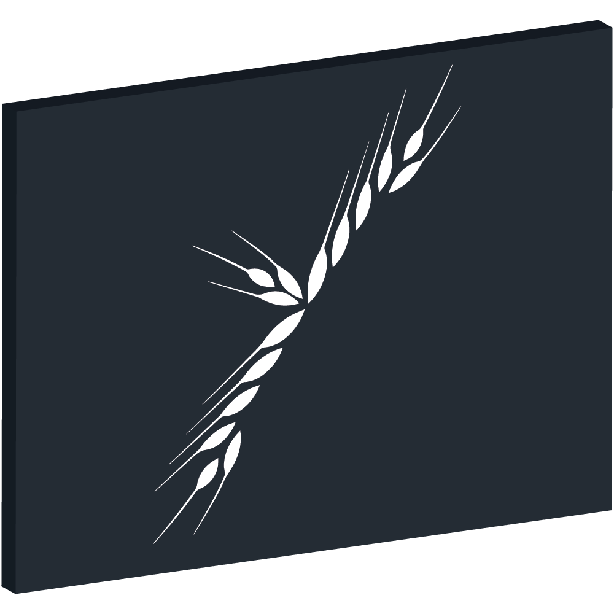

<p align="center">
    
    <br />
    <br />
    <a target="_blank" href="https://github.com/plurid/sereal/blob/master/LICENSE">
        
    </a>
    <a target="_blank" href="https://www.npmjs.com/package/@plurid/sereal">
        
    </a>
</p>

<h1 align="center">
    @plurid/sereal
</h1>

<h3 align="center">
    Real (Values and Objects) Serialization
</h3>

TypeScript implementation of the `sereal` specification. Serializes rich runtime values (primitives, built-ins, custom classes, shared references, and cycles) into human-readable, diffable JSON documents and reconstructs them safely.

---

### Contents

- [Features](#features)
- [Install](#install)
- [Usage](#usage)
- [Specification](#specification)
- [License](#license)

---

## Features

- **Format v1**: Human-readable, diffable JSON envelope (`$sereal: 1`).
- **Comprehensive Built-ins**: `BigInt`, `Date`, `RegExp`, `URL`, `Map`, `Set`, `Error` (with `cause` chains and `AggregateError`), `ArrayBuffer`, `DataView`, all TypedArrays (`Float16Array` through `BigUint64Array`), and full TC39 `Temporal` support.
- **Special Values**: `undefined`, `NaN`, `+Infinity`, `-Infinity`, `-0`, registered symbols (`Symbol.for`).
- **No Path Coupling**: Objects carry type tags; instances are recognized at any arbitrary depth or container.
- **Reference Preservation**: Shared object identities and cycles in objects, arrays, maps, and sets are retained via deterministic depth-first `id`/`ref` tagging.
- **Class Support**:
  - Class-owned via `toSereal`, `fromSereal`, `serealType` symbols.
  - External / 3rd-party via `defineType()`.
- **Evolvable Data**: Per-type versions with automatic forward migrations (`1 -> 2 -> 3`).
- **Standard Schema Integration**: Optional payload validation using any Standard Schema v1 library ([Valibot](https://valibot.dev), [Zod](https://zod.dev), [ArkType](https://arktype.io), etc.).
- **Timeline Engine**: Opt-in undo/redo history (`@plurid/sereal/timeline`) using immutable encoded snapshots.
- **Secure by Default**: Prototype pollution guarded, depth-bounded (`maxDepth`), strict constructor allowlist.

---

## Install

```bash
# npm
npm install @plurid/sereal

# pnpm
pnpm add @plurid/sereal

# bun
bun add @plurid/sereal

# deno
deno add jsr:@plurid/sereal
```

---

## Usage

```typescript
import { createSereal, defineType, toSereal, fromSereal, serealType } from '@plurid/sereal';

// 1. Symbol Protocol for classes you own
class Point {
    static readonly [serealType] = { name: 'geo.Point' };

    constructor(
        readonly x: number,
        readonly y: number,
    ) {}

    [toSereal]() {
        return { x: this.x, y: this.y };
    }

    static [fromSereal](data: { x: number; y: number }) {
        return new Point(data.x, data.y);
    }
}

// 2. defineType for 3rd-party classes
class Money {
    constructor(readonly cents: bigint) {}
}

const MoneyType = defineType(Money, {
    name: 'app.Money',
    encode: (m) => m.cents.toString(),
    decode: (str: string) => new Money(BigInt(str)),
});

const sereal = createSereal({ types: [Point, MoneyType] });

const document = sereal.encode({
    origin: new Point(0, 0),
    balance: new Money(5000n),
    created: Temporal.Now.instant(),
});

const restored = sereal.decode(document);
```

For full documentation, see the [repository root README](../../README.md).

---

## Specification

Language-neutral format specification and test vectors are documented in [`about/spec/sereal-format-v1.md`](../../about/spec/sereal-format-v1.md).

---

## [Codeophon](https://github.com/ly3xqhl8g9/codeophon)

- licensing: [delicense](https://github.com/ly3xqhl8g9/delicense)
- versioning: [αver](https://github.com/ly3xqhl8g9/alpha-versioning)
